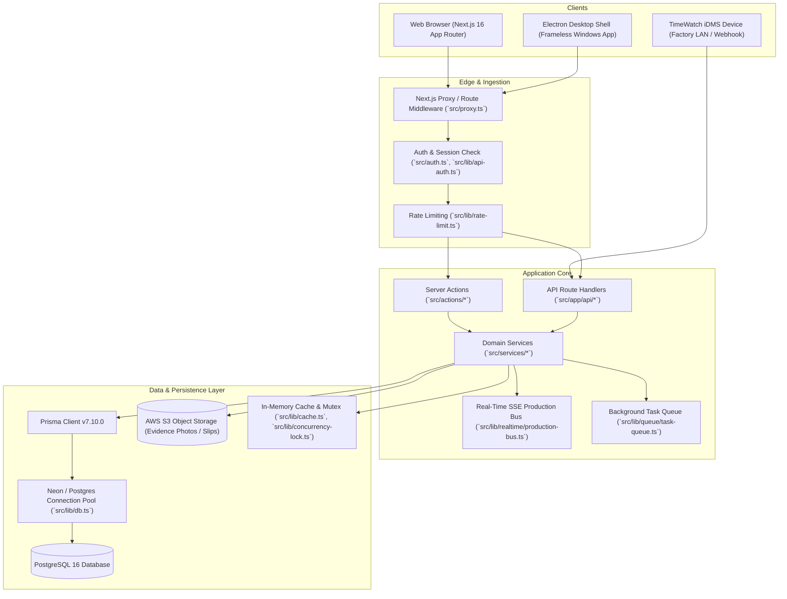

# Plexi-ERP Architecture Map & Component Topology

## 1. System Topology Overview

## 2. Core Functional Modules
1. **Security & Gate Management**: Visitor, truck entry, tare/gross weighing, camera photo verification, gate pass issuance.
2. **Inventory Management**: Raw materials receiving, stock allocation, batch/lot tracking, unit of measure conversions.
3. **Production Routes**:
   - **Tape Plant**: Granule mixture formulation, extruder parameters, tape denier/width calculation, bobbin production.
   - **Loom Section**: Circular loom weaving, roll cutting, fabric quality grading (Grade A/B/C/Rework), reading sheets.
   - **Lamination**: Extrusion coating, micron thickness, raw material consumption.
   - **Printing**: Flexographic printing, ink and solvent tracking, cylinder repeat lengths.
   - **Cutting & Bag Conversion**: Convertex & Valvomatic valve bag conversion, bottom stitching, baling.
4. **Quality Control & Rework**: Non-conformance logging, scrap attribution, RP recycling plant reprocessing.
5. **Commercial & Dispatch**: Finished goods warehouse, lot picking, invoice and packing slip generation.
6. **HR & Attendance**: TimeWatch biometric device synchronization, shift attribution (Shift A, B, C, Day/Night), attendance daily aggregations.
